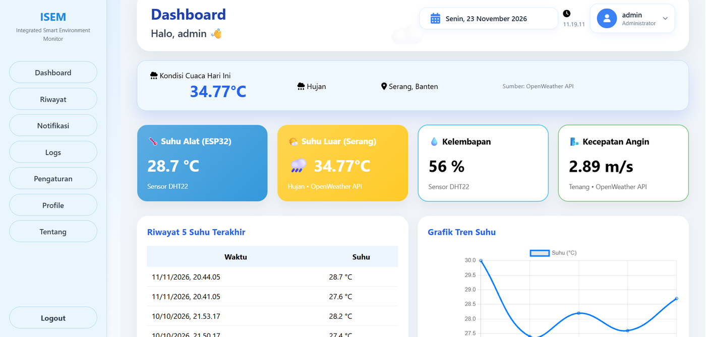
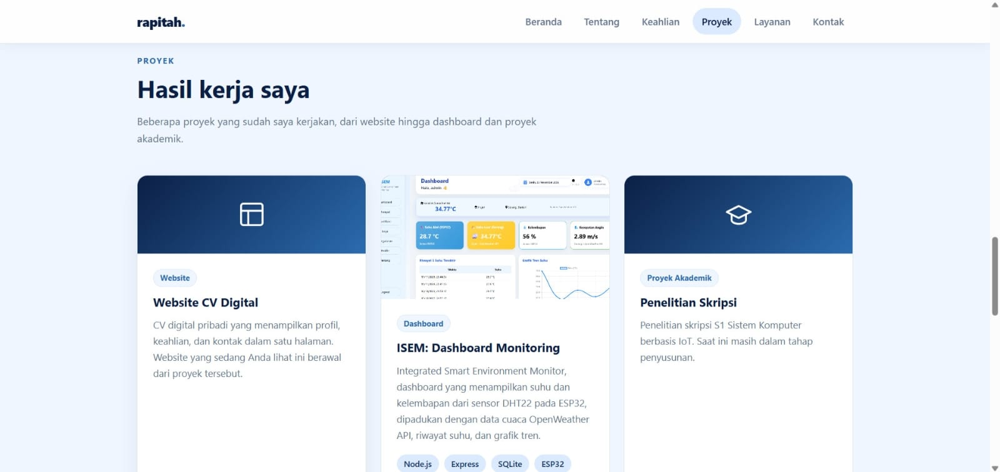

# Portofolio-Projects
A collection of my Web Development, IoT, and dashboard monitoring projects, showcasing my skills and learning journey in software development.
# My Portfolio Projects

Welcome to my project portfolio!

I am a Computer Systems student interested in Web Development and Internet of Things (IoT).

## About Me
I enjoy developing websites, web dashboards, and monitoring systems using various technologies.

## My Projects

### 1. Integrated Smart Environment Monitor (ISEM)
An IoT-based environmental monitoring system that displays temperature and humidity data through a web dashboard.

### 2. Personal Portfolio Website
A personal website showcasing my profile, skills, and digital CV.

Website: https://rapitah.my.id/

### 3. Web PLC Rapitah
A web-based PLC monitoring project consisting of HMI, Dashboard, and AC interfaces.

## Technologies
- HTML
- CSS
- JavaScript
- Node.js
- Express.js
- SQLite

---

Thank you for visiting my repository!
